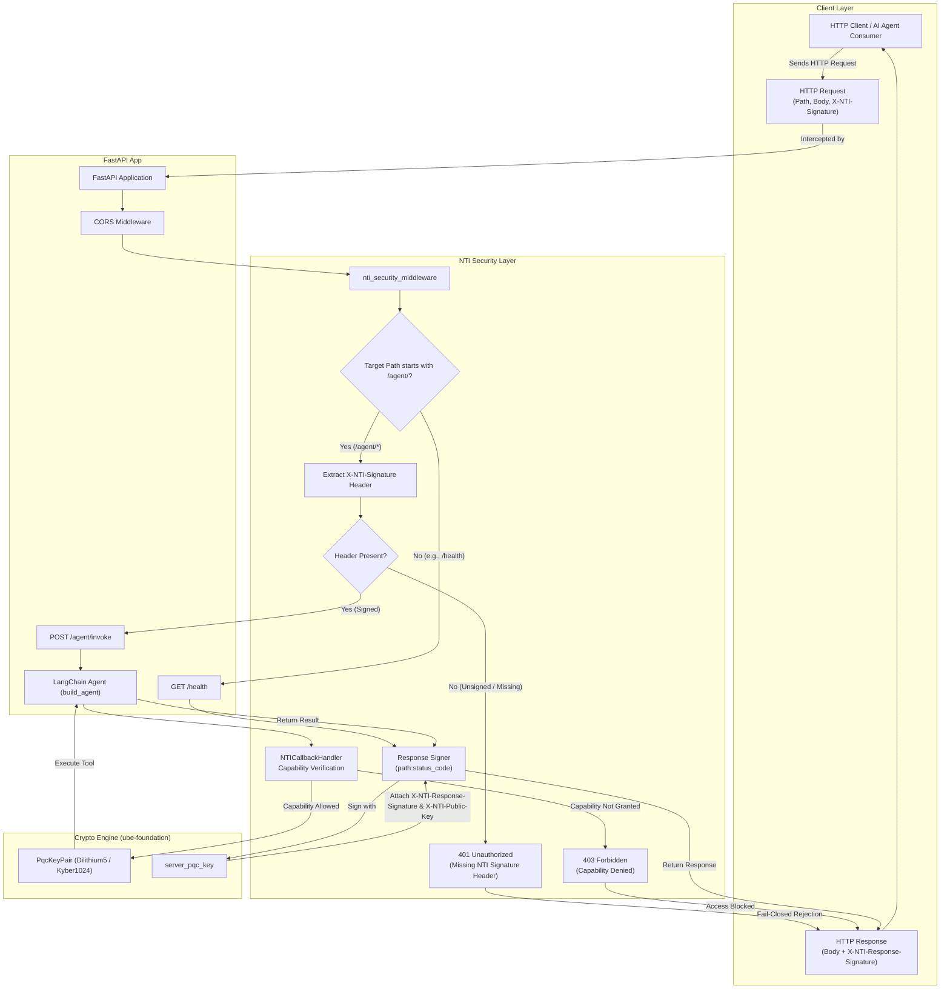

[](https://nti-registry.vercel.app)

# NTI Secure FastAPI Template

[](https://opensource.org/licenses/MIT)

A production-ready FastAPI backend serving AI agents protected by NTI (Neutral Trust Infrastructure) post-quantum security.

Every tool call is cryptographically verified before execution using all 5 pillars of NTI:
1. Zero-Trust Capability Enforcement
2. NIST Post-Quantum Cryptography (Dilithium5 / Kyber1024)
3. BFT Multi-Agent Consensus
4. Merkle-Chained Audit Trails
5. P2P Agent Mesh & State Persistence

## Quick Start

```bash
git clone https://github.com/abisheakp197/nti-fastapi-template.git my-backend
cd my-backend
pip install -r requirements.txt
cp .env.example .env
# Add your OPENAI_API_KEY to .env
python main.py
```

The server starts at `http://localhost:8000`

## API Endpoints

| Method | Endpoint | Description |
|---|---|---|
| GET | /health | Health check |
| POST | /agent/invoke | Invoke the NTI-secured agent |

### Example Request (Health Check)

```bash
curl -i http://localhost:8000/health
```

### Example Request (Agent Invoke - Unsigned, Rejected by NTI)

```bash
curl -X POST http://localhost:8000/agent/invoke \
  -H "Content-Type: application/json" \
  -d '{"input": "Transfer $100 USD to account 12345", "agent_id": "user_001"}'
```

Response:
```json
{"detail": "Missing required NTI cryptographic signature header (X-NTI-Signature)"}
```

### Example Request (Agent Invoke - Signed)

```bash
curl -X POST http://localhost:8000/agent/invoke \
  -H "Content-Type: application/json" \
  -H "X-NTI-Signature: sample_pqc_signature" \
  -d '{"input": "Transfer $100 USD to account 12345", "agent_id": "user_001"}'
```

### Example Response (Success)

```json
{"output": "Transferred 100.0 USD to account 12345", "agent_id": "user_001", "status": "success"}
```

### Example Response (Blocked by NTI Capability Enforcement)

```json
{"detail": "NTI blocked action: NTI Security Denied Action: capability not granted"}
```

## What NTI Does Here

- Intercepts requests and enforces post-quantum cryptographic signatures (`X-NTI-Signature`).
- Only tools with an explicit grant in `agent.py` can be called.
- All evaluations are logged to a Merkle-chained audit trail.
- Unauthorized or missing signature actions return HTTP 401 / 403 before execution.
- Cryptographically signs outgoing HTTP responses (`X-NTI-Response-Signature`).

## How To Add Capabilities

In `agent.py`, add a grant for any tool the agent should be allowed to call:

```python
nti_handler.grant_capability("execute_transfer")
nti_handler.grant_capability("read_account")
```

Any tool without an explicit grant is automatically blocked.

## License

MIT License. See [LICENSE](LICENSE).

## Links

- Core SDK: https://pypi.org/project/ube-foundation/
- LangChain wrapper: https://pypi.org/project/langchain-nti/
- Homepage: https://abisheakp197.github.io/Neutral-Trust-Infrastructure/

## Architecture


